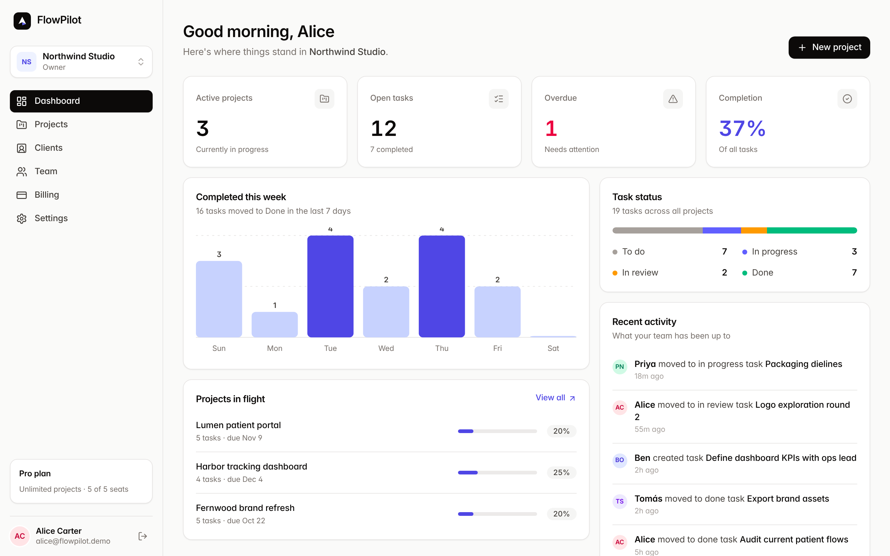
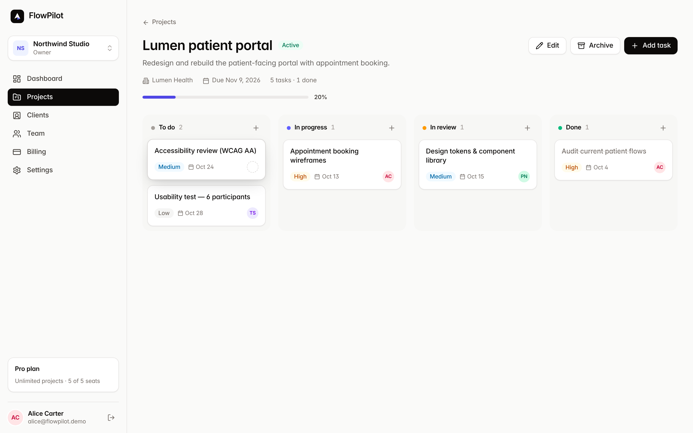
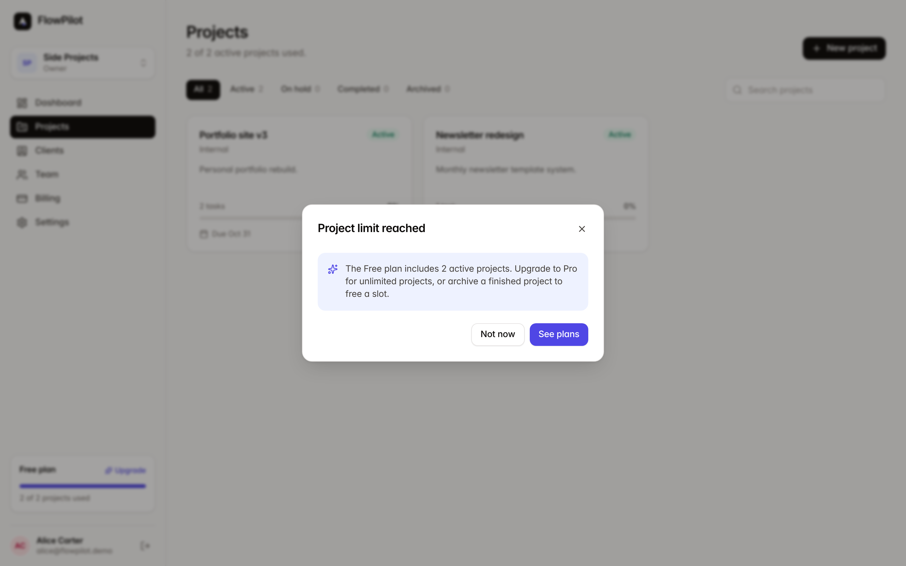
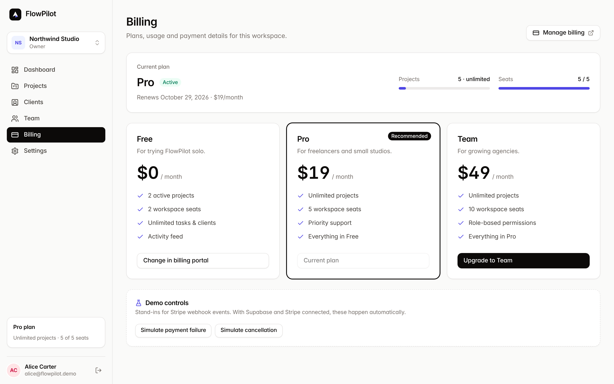
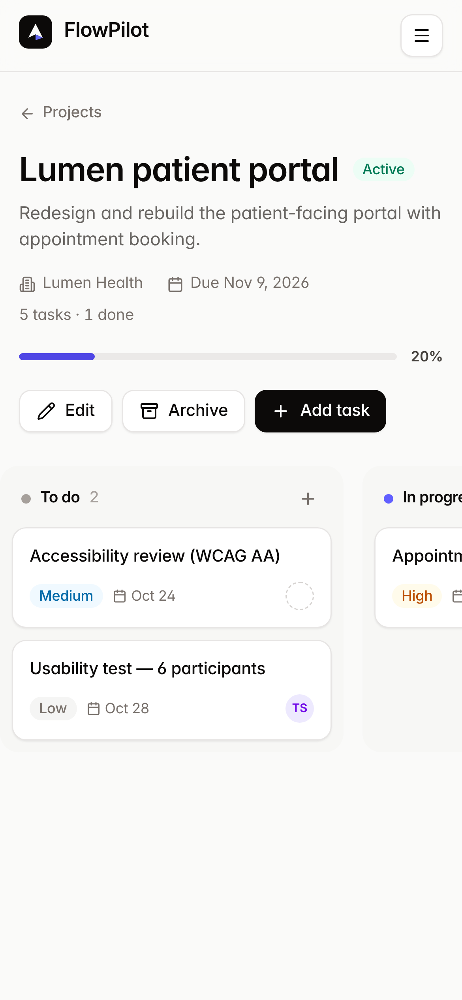

# FlowPilot — Team & Client Management SaaS

> A multi-tenant project, client and team workspace with role-based permissions and Stripe subscription billing.
> Built with **React + TypeScript + Tailwind**, **Supabase** (Auth, Postgres, RLS, Edge Functions) and **Stripe**.



| | |
|---|---|
|  |  |
|  |  |

More screenshots: [`docs/screenshots/`](docs/screenshots) · Architecture: [`docs/ARCHITECTURE.md`](docs/ARCHITECTURE.md) · Go live: [`docs/GO_LIVE.md`](docs/GO_LIVE.md)

---

## What it does

| Module | Features |
|---|---|
| **Auth** | Sign up, sign in, sign out, password reset, email verification, protected routes, session expiry handling |
| **Workspaces** | Create and switch workspaces (multi-tenant), rename, leave, delete |
| **Projects & tasks** | Projects with client + due date, archive/restore, 4-column kanban with drag-and-drop, priorities, assignees, deadlines |
| **Clients** | Directory with search; projects link to clients of the same workspace only |
| **Team** | Invitations, Owner / Admin / Member roles, seat usage, role changes (owner only) |
| **Billing** | Free / Pro / Team plans, Stripe Checkout, Customer Portal, webhook-driven subscription state |
| **Dashboard** | Live stats, weekly throughput chart, status breakdown, activity feed |
| **Quality** | Zod validation, typed errors, skeletons / empty / error states, confirmation dialogs, accessible dialogs & announcements, responsive layout |

## Run it in 60 seconds (Demo Mode)

```bash
npm ci
npm run dev          # http://localhost:5173  →  "Continue with demo account"
```

With no Supabase keys, the app runs on a **seeded in-browser backend** that enforces the same rules as the real one
(roles, tenant isolation, plan limits) — ideal for demos and E2E tests. A banner makes this explicit. Demo logins use password `Demo-Pass-123`
(`alice@` owner · `ben@` admin · `priya@` member — all `@flowpilot.demo`).

To run against the real stack, follow **[docs/GO_LIVE.md](docs/GO_LIVE.md)** (Supabase project → migrations → Stripe → Vercel).

## Security model (the interesting part)

- **Tenant isolation in the database.** Every table has RLS enabled; policies call `private.is_member(workspace_id)` (a `SECURITY DEFINER` helper in a non-exposed schema). Composite foreign keys make cross-workspace references *impossible* (a task cannot point at another workspace's project, a project cannot use another workspace's client, an assignee must be a member). `workspace_id` is immutable.
- **Least privilege grants.** Clients get only the columns/verbs they need. `workspace_members`, `workspace_invitations`, `subscriptions`, `activity_logs` are **read-only** to the browser; changes go through audited RPCs (`invite_member`, `change_member_role`, …) or the service role.
- **Roles enforced server-side.** Owner / Admin / Member rules live in policies and RPCs — hiding a button is cosmetic.
- **Billing you can trust.** Plan limits are enforced by DB triggers from `subscriptions`, which only the Stripe webhook can write. Only `active` / `trialing` grant paid limits; `past_due`, `canceled`, etc. fall back to Free.
- **Stripe webhooks**: raw-body signature verification, idempotency via a primary key on `stripe_events`, state re-fetched from Stripe (so out-of-order delivery can't regress state), claim released on failure so retries succeed.
- **Checkout**: the browser sends a plan *name*; the server picks the price ID, after verifying the caller is the workspace owner.
- Secrets: only the public anon key is in the frontend. Service-role and Stripe keys exist only as Edge Function secrets.

## Tests — what is verified

```bash
npm test            # 107 tests: unit + component + database security
npm run test:e2e    # 17 browser tests (Playwright, production build)
npm run typecheck && npm run lint
```

| Suite | Tests | What it proves |
|---|---|---|
| `tests/integration/rls.test.ts` | **46** | The **actual migration files** run on real PostgreSQL (PGlite/WASM): cross-tenant read/update/delete/insert blocked, privilege-escalation attempts rejected, billing tables unwritable by clients, plan & seat limits enforced by triggers, payment-failure downgrade, invitations, activity log |
| `supabase/functions/_shared/*.test.ts` | 17 | Webhook handler: repeat delivery = no side effects (BILL-02), retry after failure, out-of-order events, plan mapping, owner-only billing |
| `src/**/*.test.ts(x)` | 44 | Validation, error mapping, utilities, demo-backend rules, UI primitives |
| `tests/e2e` | **17** | Auth redirects, signup, project create + reload persistence, drag-and-drop persistence, plan-limit → upgrade → test checkout, payment-failure policy, role-restricted UI, tenant isolation by URL, mobile layout |

IDs from the plan (AUTH-01/02, PRJ-01/02, RLS-01/02, BILL-01…04, UI-01) are referenced in test names.

### Honest limits of the verification
- RLS/trigger/RPC tests run on PGlite with a **minimal stub of Supabase's `auth` schema** (not a full Supabase stack).
- The Stripe **Edge Function wrappers** (`create-checkout`, `billing-portal`, the Deno entrypoint of `stripe-webhook`) are thin glue and are **not executed in CI**; their decision logic is unit-tested. Verify them once end-to-end with Stripe test mode ([GO_LIVE.md](docs/GO_LIVE.md) §4, `stripe trigger`).
- E2E runs in Demo Mode, not against a live Supabase project.

## Project structure

```
src/
  components/{ui,layout,dashboard,projects}   design-system primitives + feature components
  features/{auth,workspaces,projects,tasks,clients,team,billing,dashboard}   hooks & providers
  services/            api.ts (contract) · supabaseApi.ts (real) · demoApi.ts + demoSeed.ts (demo)
  lib/                 config (plans, roles) · validation (zod) · errors · utils · supabase client
  routes/              pages
supabase/
  migrations/          schema → security (RLS, grants) → logic (RPCs, triggers, limits)
  functions/           create-checkout · billing-portal · stripe-webhook · _shared (pure, tested logic)
  seed.sql             local demo users + data
tests/{e2e,integration}   Playwright + Postgres-backed security tests
.github/workflows/ci.yml  typecheck → lint → tests → build → E2E (→ optional Supabase deploy)
```

## Trade-offs & known gaps

- **Invitations are in-app**: the invitee sees a banner after signing in with the invited email. No email delivery is wired (add Resend/Postmark in an Edge Function).
- Kanban drag-and-drop is mouse/touch-HTML5; keyboard users move cards via the task dialog's Status field. Touch-drag on some mobile browsers is limited for the same reason.
- Light theme only. Order *within* a column isn't user-sortable (new/moved cards go to the bottom).
- Stripe plan prices are demo values, test mode only.
- Dashboard stats are computed client-side from query results (fine to a few thousand rows; move to a SQL view/RPC beyond that).
- Sentry: `reportError()` in `src/lib/errors.ts` is the single hook to wire it in.

## License
MIT — see `LICENSE`.
