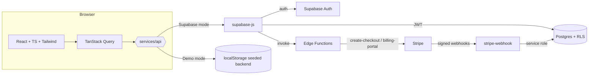

# Architecture

## Data flow principles
1. **The UI never decides authorization.** `can.*` in `lib/config.ts` only hides controls; Postgres policies/RPCs decide.
2. **One API contract** (`services/api.ts`) with two implementations, so the UI is identical in demo and production and E2E tests are fast.
3. **Server-side truth for billing.** Checkout success redirects prove nothing; the UI polls entitlements which derive from the webhook-written `subscriptions` row.

## Database
`profiles` · `workspaces` · `workspace_members` · `workspace_invitations` · `clients` · `projects` · `tasks` · `subscriptions` · `stripe_events` · `plan_limits` · `activity_logs`

Migrations: `…0001_schema.sql` (tables, constraints, indexes) → `…0002_security.sql` (helpers, grants, RLS) → `…0003_logic.sql` (signup bootstrap, RPCs, plan-limit & audit triggers).

### Permission matrix
| Action | Owner | Admin | Member |
|---|---|---|---|
| Read workspace data | ✓ | ✓ | ✓ |
| Create/update tasks, projects | ✓ | ✓ | ✓ |
| Create/update clients | ✓ | ✓ | ✓ |
| Delete clients / projects | ✓ | ✓ | – |
| Invite members | ✓ | ✓ (members only) | – |
| Change roles | ✓ | – | – |
| Manage subscription | ✓ | – | – |
| Delete workspace | ✓ | – | – |

### Billing policy
| Stripe status | Effective plan |
|---|---|
| `active`, `trialing` | purchased plan |
| `past_due`, `unpaid`, `canceled`, `incomplete*` | **Free** limits (data is never deleted) |

## Performance notes
Indexes on every policy/filter column (`workspace_id`, `user_id`, `project_id`, `assigned_to`, `(workspace_id, created_at desc)`); `(select auth.uid())` wrapped for per-statement caching; route-level code splitting (main bundle ≈ 95 kB gzip).
